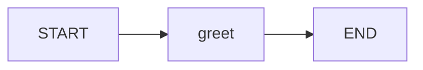
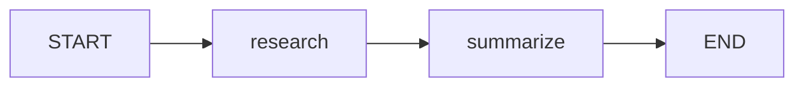
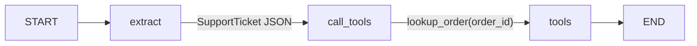
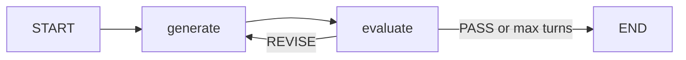

# Part 2: LangChain flows — 12 slides + break

Live demo scripts live in `scripts/`. Run the matching file when you hit a **code** slide.

| # | Slide | Script |
|---|---|---|
| 1 | Section divider: Part 2 — LangChain flows | — |
| 2 | Step 1: Single node (concept) | — |
| 3 | Step 1: Single node (code) | `01_single_node.py` |
| 4 | Step 2: Chain (concept + flow diagram) | — |
| 5 | Step 2: Chain (code) | `02_chain.py` |
| 6 | Why structured output | `03_structured_why.py` |
| 7 | Defining a schema | `04_structured_schema.py` |
| 8 | Structured output between nodes + tools | `05_structured_between_nodes.py` |
| 9 | Step 3: Loop (concept + diagram) | — |
| 10 | Step 3: Loop (code) | `06_loop.py` |
| 11 | Recap: node → chain → structured output → loop | `07_recap.py` |
| 12 | Recap visual / Q&A | — |
| — | **Break** (1 slide) | — |

Running story on every live script: **Priya / Acme / order #4821 / missing keys**.

---

## 1. Section divider

**Part 2 — LangChain flows**

Build the same support ticket through four shapes:

`node → chain → structured JSON → loop`

---

## 2–3. Step 1: Single node

A **node** is a function: `state in → state out`.

Talking point: no LLM required to understand the graph. `01_single_node.py` is a deterministic greet node so the slide stays small.

---

## 4–5. Step 2: Chain

A **chain** is nodes with a fixed edge: A’s output is B’s input.

`02_chain.py`: ticket → key points → one-line brief.

---

## 6. Why structured output

Side-by-side the same ticket:

| Free text | JSON |
|---|---|
| Next node has to *read* | Next node can *index a field* |
| Tone, extra sentences, missing ids | `order_id`, `request` |
| Fine for humans | Required for tools and routing |

`03_structured_why.py` shows prompting for JSON still isn’t a contract.

---

## 7. Defining a schema

Pydantic model on the left, `model_json_schema()` / dumped instance on the right.

`04_structured_schema.py` uses `with_structured_output(SupportTicket)`.

---

## 8. Between nodes and in tool calls

Two contracts:

1. **Node → node:** extract writes a typed ticket; the tool node never parses prose.
2. **Model → tool:** `bind_tools` makes `order_id` a schema-valid argument.

---

## 9–10. Step 3: Loop

`06_loop.py`: generate a reply, grade it with a structured `Verdict`, loop.

---

## 11. Recap

| Shape | What it gives you |
|---|---|
| Node | One unit of work |
| Chain | Fixed pipeline |
| Structured output | A contract between steps and tools |
| Loop | Retry until a structured check passes |

`07_recap.py` composes all four on the same ticket.

---

## Break

**5–10 min.** Next section after the break.
